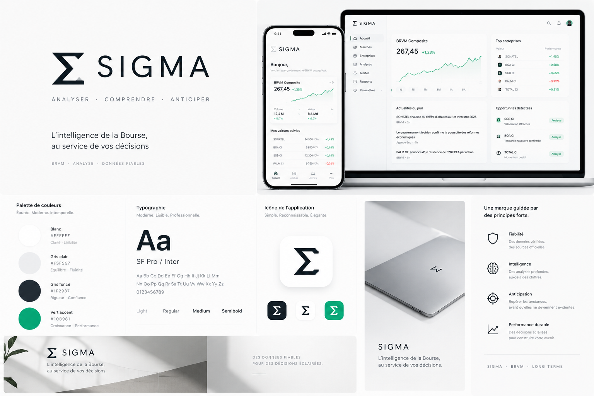

# SIGMA — Cahier des charges v1

## Application personnelle d'analyse BRVM

**Version :** 1.1 — 19 octobre 2026 (planche de marque et maquettes intégrées)
**Statut :** prêt à transmettre à une IA codeuse, par lots
**Produit :** web app responsive (mobile d'abord, desktop complet), mono-utilisateur, gratuite à opérer ou presque

## Planche de marque et maquette de référence — intégrée au présent CDC



*Image normative pour l'identité, la hiérarchie et l'ambiance des interfaces. Les noms de sociétés, cours, variations et actualités visibles sur cette planche sont des contenus de démonstration propres à la maquette : ils ne doivent jamais être repris comme des données réelles dans l'application. En cas de conflit entre l'image et le texte du présent CDC (libellés, ordre des blocs, règles de données), le texte du CDC prévaut. Le fichier image accompagne le CDC dans `SIGMA-assets/` et doit être transmis avec lui à l'IA codeuse, puis rangé dans `docs/assets/` du dépôt du projet.*

> **SIGMA — Analyser · Comprendre · Anticiper**
> « L'intelligence de la Bourse, au service de vos décisions. »

Le signe Σ (somme) exprime l'idée fondatrice du produit : agréger des sources dispersées — cours officiels, bulletins de la cote, rapports des sociétés, dividendes, actualités — en une lecture unique, claire et vérifiable.

---

# 1. Vision

## 1.1 Problème

Investir à la BRVM demande de rassembler manuellement :

- les cours et le Bulletin Officiel de la Cote (BOC) ;
- les rapports trimestriels, semestriels et annuels des sociétés ;
- les avis de dividendes et les dates de détachement/paiement ;
- les actualités de marché et le contexte économique ;
- les ratios permettant de juger si une société est solide, rentable, généreuse en dividendes — et si son prix est raisonnable.

Ce travail est long, dispersé et décourageant pour un investisseur débutant qui dispose de peu de temps. Les services premium existants font une partie de ce travail, mais sont payants et leurs recommandations restent des boîtes noires.

## 1.2 Promesse SIGMA

> En ouvrant SIGMA quelques minutes, à n'importe quel moment, je sais ce qui a changé, je comprends une société en français simple avec les preuves sous les yeux, et je prépare ma décision mensuelle avec méthode.

SIGMA est un outil **d'information et d'apprentissage**, pas un conseiller financier. Il ne dit jamais « achète » ou « vends ». Il produit des scores explicables, des alertes factuelles et des questions à examiner. La décision finale, passée chez la SGI de l'utilisateur, reste humaine et documentée dans un journal.

## 1.3 Utilisateur unique (persona réel)

- Investisseur débutant réel à la BRVM ; compte-titres SGI ouvert ou en cours d'ouverture.
- Capacité d'investissement indicative : **100 000 à 300 000 FCFA par mois**.
- Horizon : **10 ans**, objectif de construction patrimoniale / liberté financière progressive.
- Style retenu : **patient, qualité + dividendes**, décisions d'achat environ mensuelles ; rachète éventuellement une baisse uniquement si la thèse fondamentale reste intacte.
- Temps : sessions courtes et irrégulières, « quand j'ai le temps », principalement sur mobile, analyses longues possibles sur desktop.
- Niveau : explications en français simple d'abord, détails techniques dépliables, apprentissage progressif intégré.

## 1.4 Principes non négociables

1. **Source ou rien.** Tout chiffre affiche sa source et sa date. Une donnée inconnue s'affiche « Non disponible », jamais estimée en silence.
2. **Les chiffres sont calculés par du code.** L'IA générative, si elle est activée plus tard, résume et explique uniquement à partir de documents fournis ; elle ne produit aucun chiffre de marché ou financier.
3. **Aucune boîte noire.** Chaque score se décompose en sous-indicateurs visibles avec leurs valeurs brutes.
4. **L'incertitude est visible.** Fraîcheur des données, complétude, avertissements et indice de confiance font partie de l'interface.
5. **Calme par conception.** Pas de gamification, pas de rouge agressif partout, pas d'incitation à trader. Les variations quotidiennes ne sont jamais présentées comme des urgences.
6. **Le minimalisme sert la lecture.** Un élément visuel qui n'améliore ni la hiérarchie, ni la comparaison, ni la compréhension est supprimé.
7. **Aucune promesse de profit.** Les performances passées et les scores ne préjugent pas des performances futures.

## 1.5 Critères de succès du MVP (à 90 jours d'usage)

Le succès se mesure au processus, pas au rendement :

- données de clôture disponibles pour au moins 98 % des séances, avec alerte visible en cas d'échec ;
- les ~47 sociétés cotées disposent d'une fiche avec source et niveau de confiance ;
- le briefing d'accueil est lisible en moins de 2 minutes ;
- chaque décision d'achat réelle est précédée d'une entrée au journal indiquant la thèse ;
- l'utilisateur peut expliquer, sans ouvrir un autre site, pourquoi chaque ligne de son portefeuille est détenue ;
- coût d'exploitation : 0 FCFA hors éventuelle API IA optionnelle plafonnée.

---

# 2. Périmètre

## 2.1 MVP — inclus

| Domaine | Inclus |
|---|---|
| Données | Cours de clôture quotidiens (OHLCV si disponible), indices, BOC officiel, référentiel des sociétés, dividendes, rapports officiels indexés |
| Accueil | Briefing post-clôture : marché, watchlist, événements, prochaine échéance |
| Marché | Indices, palmarès, volumes, tableau des valeurs |
| Entreprises | Fiche société en 3 niveaux, graphique de cours, dividendes, fondamentaux, documents |
| Analyses | Scores par piliers, classement filtrable, comparateur simple, « Décision du mois », « Checklist baisse » |
| Portefeuille | Portefeuille réel saisi manuellement, portefeuille virtuel séparé, watchlist, journal de décision |
| Alertes | Centre d'alertes dans l'app (événements factuels, badges non lus) |
| Rapports | Bibliothèque des documents officiels et des synthèses générées de façon traçable |
| Plateforme | PWA responsive, données personnelles locales, export/import JSON |

## 2.2 V2 — après validation du MVP

- Extraction assistée par IA des rapports PDF avec file de vérification humaine.
- Résumés d'actualités et de rapports avec citations de pages.
- Backtest honnête des scores (survivorship et frais documentés) avant tout renforcement de leur poids visuel.
- Notifications push limitées aux événements majeurs, ou bot Telegram.
- Comparateur sectoriel avancé.
- Séries macro/matières premières automatisées, cartes de scénarios conditionnels et alertes de seuil du module Contexte (§16), une fois les sources validées.
- Laboratoire d'hypothèses : tests statistiques reproductibles de saisonnalité, d'effets de calendrier et de structure de marché (§16.6) ; aucun résultat n'entre dans l'interface quotidienne sans statut « robuste descriptif » documenté.
- Mode sombre complet.
- Synchronisation chiffrée multi-appareils.

## 2.3 Explicitement hors périmètre / jamais en V1

- Passage d'ordres, connexion à une SGI, exécution automatique.
- Flux temps réel ou promesse de données « première minute » : SIGMA travaille en **fin de journée (EOD)**.
- Prédiction de cours, objectif de prix présenté comme fiable, signal d'achat/vente.
- Reproduction de contenus premium payants de tiers (ex. contenus derrière paywall, consensus d'analystes propriétaire).
- Produit public multi-utilisateur, abonnement, paiement.
- Scraping agressif, contournement de paywall ou d'authentification.

---

# 3. Parcours essentiels

## 3.1 Ouvrir SIGMA 2 minutes

1. L'accueil affiche la date de dernière clôture et l'état des données.
2. L'utilisateur lit : variation des indices, 3 événements maximum sur sa watchlist, prochain dividende/résultat.
3. Il peut marquer les alertes comme lues ou ouvrir une fiche.

**Résultat attendu :** savoir s'il y a quelque chose à examiner, sans devoir scanner 47 lignes.

## 3.2 Comprendre une société

1. Recherche par nom ou ticker.
2. Lecture du verdict factuel en une phrase (niveau 1).
3. Lecture des 3 à 5 raisons chiffrées (niveau 2).
4. Si besoin : ratios, graphiques, historique financier et documents sources (niveau 3).
5. Actions possibles : ajouter à la watchlist, comparer, ajouter une note, ouvrir la décision du mois.

**Résultat attendu :** répondre à « solide ? rentable ? dividende durable ? prix raisonnable ? liquide ? qu'est-ce qui peut mal tourner ? »

## 3.3 Décision du mois

1. L'utilisateur saisit le montant disponible (pré-rempli avec sa fourchette habituelle).
2. SIGMA filtre des candidates selon des règles visibles : confiance données suffisante, liquidité minimale, prix unitaire compatible avec le budget, diversification sectorielle.
3. Pour chaque candidate : nombre de titres achetable, montant investi, reste en espèces, frais **estimés selon les paramètres SGI saisis par l'utilisateur**, piliers forts/faibles.
4. L'utilisateur compare, puis rédige sa thèse dans le journal avant tout achat réel chez sa SGI.
5. Après exécution externe, il saisit la transaction réelle (date, quantité, prix, frais).

**SIGMA ne classe pas une « meilleure action à acheter ».** Il présente une shortlist documentée et les arbitrages.

## 3.4 Une valeur suivie baisse fortement

1. Une alerte factuelle apparaît (ex. « −12 % sur 5 séances »).
2. La Checklist baisse classe les causes possibles connues : détachement de dividende, baisse générale du marché, baisse sectorielle, publication de la société, cause non identifiée.
3. L'utilisateur relit sa thèse initiale et répond : bénéfices ? dividende ? endettement/activité ? nouvelle information ?
4. Il conclut lui-même : thèse intacte, thèse fragilisée, ou information insuffisante. La conclusion est journalisée.

**Résultat attendu :** empêcher à la fois la vente panique et le rachat automatique d'un « couteau qui tombe ».

## 3.5 Après un achat chez la SGI

1. Saisie manuelle de la transaction réelle.
2. SIGMA met à jour quantité, prix de revient moyen, exposition sectorielle et dividendes attendus connus.
3. La thèse du journal reste attachée à la ligne.

---

# 4. Navigation et écrans

## 4.1 Navigation

**Desktop / tablette :** barre latérale claire.

- Accueil
- Marché
- Entreprises
- Analyses
- Alertes (badge numérique discret)
- Rapports
- Portefeuille
- Paramètres

**Mobile :** barre inférieure à 5 entrées maximum.

- Accueil · Marché · Portefeuille · Alertes · Plus

« Plus » donne accès à Entreprises, Analyses, Rapports et Paramètres. La recherche globale (nom/ticker) est accessible depuis l'en-tête sur tous les écrans.

> Distinction à respecter : **Marché** = la séance, les indices, les cours et les volumes. **Entreprises** = le répertoire et les fiches fondamentales. **Analyses** = les scores comparatifs, la Décision du mois et les checklists. Aucun doublon de contenu entre ces sections.

## 4.2 Accueil / Briefing

Ordre strict de lecture :

1. **En-tête de confiance** : « Dernière clôture : [date] · Données mises à jour le [date/heure] » ; bandeau d'avertissement si les données sont périmées ou incomplètes.
2. **Le marché en bref** : BRVM Composite, BRVM 30, BRVM Prestige ; valeur échangée ; nombre de hausses/baisses. Graphique d'indice épuré (1M par défaut ; 1J/1S/3M/1A/5A en options).
3. **Mes valeurs suivies** : uniquement watchlist + portefeuille ; cours, variation du jour, événement éventuel. Maximum 5 lignes visibles avant défilement.
4. **Événements à connaître** : au maximum 3 cartes classées par pertinence personnelle : résultat publié, dividende annoncé/prochain détachement, baisse/hausse inhabituelle à examiner.
5. **Actualités du jour** : titres sourcés et datés, lien vers la source d'origine ; aucun texte tiers recopié intégralement.
6. **Prochaine action utile** (contextuelle, non commerciale) : ex. « 1 fiche à relire avant la décision du mois », affichée seulement si pertinente.

États obligatoires : chargement squelette, aucune valeur suivie, données périmées, séance non ouvrable/jour férié, erreur de mise à jour.

## 4.3 Marché

- Cartes indices avec variation jour et depuis le 1er janvier si disponible.
- Palmarès : plus fortes hausses/baisses, plus gros volumes en valeur — toujours avec mention de la liquidité (un fort pourcentage sur un très faible volume doit être signalé).
- Tableau complet des valeurs : ticker, nom, clôture, variation, volume titres, valeur échangée, plus haut/bas si disponibles.
- Recherche, filtre par secteur, tri par colonne.
- Lien vers le BOC PDF officiel du jour dans Rapports.

## 4.4 Entreprises — répertoire

- Liste/cartes sobres des sociétés : nom, ticker, secteur, pays, cours, rendement de dividende net connu, mini-indicateur des 5 piliers, indice de confiance.
- Filtres : secteur, pays, dividende versé sur la dernière année connue, liquidité, confiance des données.
- Aucun tri par défaut présenté comme un classement de recommandation : tri initial alphabétique ou par capitalisation, libellé explicite.

## 4.5 Fiche entreprise

### Niveau 1 — L'essentiel (toujours visible)

- Nom, ticker, secteur, pays, cours de clôture et date.
- Phrase de synthèse factuelle générée à partir des piliers, ex. : « Activité rentable et dividende régulier sur la période connue ; valorisation supérieure à la médiane sectorielle ; liquidité moyenne. »
- 5 piliers en barres discrètes avec libellés : **Solidité, Dividende, Croissance, Prix, Liquidité**.
- Indice de confiance des données (A/B/C) avec explication au clic.
- 4 chiffres maximum : capitalisation (si calculable et sourcée), PER, rendement de dividende net, dividende par action du dernier exercice connu.

### Niveau 2 — Pourquoi (visible sans clic sur desktop, accordéon sur mobile)

- 3 à 5 puces positives et points de vigilance, chacune avec valeur brute, période et source.
- Historique dividende : années de versement, montants nets, dates ex-dividende/paiement.
- Résumé d'activité en français simple : ce que fait l'entreprise, comment elle gagne de l'argent, principaux risques génériques du secteur (formulés comme questions, pas comme certitudes).
- Prochaines échéances connues.

### Niveau 3 — Preuves (dépliable)

- Graphique de cours historique avec dividendes détachés repérés ; périodes 6M/1A/3A/5A/max disponible.
- Tableau financier annuel 5 ans maximum : chiffre d'affaires ou PNB (banques), résultat net, bénéfice net par action, capitaux propres, dividende par action, nombre d'actions si disponible.
- Ratios calculés : PER, P/B, rendement net, payout, ROE, marge nette ; formule affichable en infobulle/page d'aide.
- Publications intermédiaires séparées des données annuelles auditées, jamais mélangées sans étiquette.
- Documents sources : liens vers les rapports et avis officiels, date de publication, type de document.
- Bloc « Ce que SIGMA ne sait pas » : champs manquants, données anciennes, ratios non calculables et pourquoi.

### Terminologie pédagogique

Chaque terme technique (PER, P/B, ROE, payout, ex-dividende…) dispose d'une définition d'une phrase dans un glossaire intégré, accessible par tap/clic sans quitter la fiche.

## 4.6 Analyses

### Classement par piliers

- Tableau comparable des sociétés, un pilier trié à la fois ; le score global de tri est secondaire, moins visible que les piliers.
- Filtres par secteur et niveau de confiance.
- Avertissement fixe : « Un score décrit des caractéristiques passées selon les règles affichées. Ce n'est ni une recommandation ni une prévision. »

### Comparateur

- 2 à 4 sociétés côte à côte, mêmes définitions, mêmes périodes lorsque possible ; différences de période signalées.
- Même secteur recommandé par l'interface, sans l'interdire.

### Décision du mois

Voir parcours 3.3. Paramètres modifiables et visibles : budget, liquidité minimale, exclusion éventuelle de secteurs, plafond indicatif d'exposition par secteur (défaut 35 % du portefeuille, simple repère), paramètres de frais SGI.

### Checklist baisse

Voir parcours 3.4. Seuils par défaut configurables : −10 % sur 5 séances ou −15 % sur 20 séances, ou écart inhabituel par rapport à l'indice sur la même période. Le libellé reste « à examiner », jamais « opportunité ». La checklist consulte obligatoirement, dans cet ordre : détachement de dividende, mouvement de marché au sens du §16.5 (concentration et largeur), mouvement sectoriel, publication propre à la société, événement de contexte documenté — puis seulement « cause non identifiée ».

### Contexte & scénarios (onglet Analyses)

Voir le système complet au §16. En interface quotidienne, l'onglet contient uniquement :

- un **calendrier d'événements datés et sourcés** (BCEAO, budgets, campagnes agricoles, grandes échéances publiques, publications) filtré par défaut sur la watchlist et le portefeuille ;
- des **cartes de contexte** liant un fait daté aux sociétés suivies exposées, avec le stade de maturité de l'événement (annonce → résultats, §16.3) et les indicateurs à vérifier ;
- un accès au **journal des hypothèses** de l'utilisateur.

Aucune carte de contexte ne modifie un score ni ne produit de libellé d'achat/vente.

### Structure du marché (dans Marché et Analyses)

Indicateurs calculés chaque soir à partir de la cote : poids des 5 et 10 plus grandes capitalisations, part des 5 valeurs les plus échangées dans la valeur totale, largeur (nombre de hausses/baisses/inchangées et variation médiane des valeurs), valeurs sans échange. Leur rôle est d'éviter de confondre « l'indice baisse » et « mes sociétés vont mal » lorsque le mouvement vient d'une ou deux très grandes capitalisations. Détail et garde-fous au §16.5.

## 4.7 Portefeuille

- Deux espaces strictement séparés et identifiés par un libellé permanent : **Réel (saisi manuellement)** et **Virtuel (simulation)**.
- Lignes : quantité, prix de revient moyen, dernier cours EOD, valeur de marché, plus/moins-value latente hors frais de revente, poids dans le portefeuille.
- Répartition par secteur et par société (graphique sobre, pas de camembert illisible au-delà de 8 catégories).
- Dividendes : encaissés saisis, annoncés à venir avec dates ; distinguer brut/net et le pays de retenue lorsque l'information officielle le précise.
- Contributions mensuelles et performance affichée avec la méthode utilisée ; en MVP, privilégier les montants versés, la valeur actuelle et les dividendes encaissés plutôt qu'un taux de rendement trompeur.
- **Journal de décision** rattaché à chaque transaction : date, thèse, risques identifiés, ce qui invaliderait la thèse, conclusion des checklists ultérieures. Horodaté, modifiable uniquement par ajout d'une note datée (pas de réécriture silencieuse de l'historique).

## 4.8 Alertes

Événements factuels uniquement :

- nouveau rapport officiel pour une valeur suivie/détenue ;
- avis de dividende, approche de la date ex-dividende ou de paiement ;
- variation dépassant les seuils de checklist ;
- échec ou retard de mise à jour des données ;
- donnée fondamentale corrigée.

Chaque alerte comporte : fait, date, source, valeur concernée, statut lu/non lu. MVP : alertes **dans l'app uniquement**, aucune notification push.

## 4.9 Rapports

- BOC officiels par date, avec lien/téléchargement de la source.
- Bibliothèque par société : avis, rapports d'activité trimestriels/semestriels, rapports annuels/états financiers.
- Synthèses SIGMA éventuelles, séparées visuellement des documents sources, avec méthode (« calculs automatiques » ou « résumé IA vérifié/non vérifié ») et liens de preuve.
- Recherche par société, type et année.

## 4.10 Paramètres

- Profil d'investissement indicatif : budget mensuel habituel, horizon, seuils de checklist.
- SGI : nom libre, paramètres de frais saisis par l'utilisateur (courtage %, minimum, autres frais) — aucune valeur par défaut inventée ; tant qu'ils sont vides, la Décision du mois affiche « frais non estimés ».
- Données : date de dernière mise à jour, rapport de qualité, export/import JSON du portefeuille et du journal, réinitialisation locale.
- Affichage : densité des tableaux (confort/compact), glossaire, mentions d'information.
- Clé API IA optionnelle (V2) : saisie locale uniquement, jamais committée ni envoyée ailleurs qu'au fournisseur choisi.

## 4.11 Maquettes fonctionnelles normatives

La planche SIGMA intégrée en tête de ce CDC fixe le traitement visuel : fond blanc, sidebar claire sur desktop, cartes séparées par des filets gris très clairs, grand graphique d'indice, listes de valeurs sobres, chiffres anthracite et accent vert discret. Les schémas ci-dessous fixent le **zoning et l'ordre de lecture** que l'IA codeuse doit reproduire. Tous les contenus entre crochets sont des emplacements fonctionnels, pas des valeurs réelles.

### Lecture normative de la planche fournie

- **Mobile (au centre de la planche)** : salutation brève, carte « BRVM Composite » avec courbe, deux indicateurs de séance, puis liste « Mes valeurs suivies ». Cet ordre est conservé, avec ajout obligatoire de la date de clôture au-dessus de la carte d'indice.
- **Desktop (à droite de la planche)** : navigation latérale, grand graphique à gauche, colonne secondaire à droite, actualités sous le graphique. Cette composition est conservée pour l'Accueil et sert de gabarit aux autres écrans.
- **Adaptations imposées par le CDC** : le bloc appelé « Opportunités détectées » sur la planche devient « À examiner selon vos critères » ; un bloc de fraîcheur/source est ajouté ; « Portefeuille » entre dans la navigation ; aucun bouton ne doit laisser entendre une recommandation d'achat.
- **Bas de la planche** : palette, typographie SF Pro/Inter et variantes d'icône Σ sont reprises telles quelles dans le design system du §9.

### Gabarit global

```text
DESKTOP ≥ 1024 px
┌────────────┬──────────────────────────────────────────────────────────┐
│ Σ SIGMA    │ [Rechercher un nom ou un ticker]      [Alertes] [⚙]      │
│            ├──────────────────────────────────────────────────────────┤
│ Accueil    │ Dernière clôture : [date] · Source : BRVM · Maj [heure]  │
│ Marché     │                                                          │
│ Entreprises│   Contenu max. 1180 px, marges 32 px, grille 12 col.     │
│ Analyses   │                                                          │
│ Alertes ②  │                                                          │
│ Rapports   │                                                          │
│ Portefeuille                                                          │
│ Paramètres │                                                          │
└────────────┴──────────────────────────────────────────────────────────┘
Sidebar 232 px, fond blanc, filet vertical #E5E7EB. En-tête 64 px.

MOBILE < 768 px
┌──────────────────────────────────────────────┐
│ Σ SIGMA                         [Recherche]  │
│ Dernière clôture : [date] · [état données]   │
├──────────────────────────────────────────────┤
│   Contenu en une colonne, marges 16 px       │
│                                              │
├──────────────────────────────────────────────┤
│ Accueil │ Marché │ Portefeuille │ Alertes │ + │
└──────────────────────────────────────────────┘
Barre inférieure ≥ 64 px + zone sûre ; cibles tactiles ≥ 44 px.
```

### Maquette A — Accueil / Briefing

```text
DESKTOP
[Accueil]                                      [Bandeau fraîcheur si besoin]
┌─────────────────────────────────────┐  ┌──────────────────────────────┐
│ BRVM Composite                      │  │ À CONNAÎTRE (3 max.)         │
│ [niveau]  [+/- variation]           │  │ • [résultat publié + source] │
│  ╭──────── courbe verte fine ────╮   │  │ • [dividende + date]         │
│  1J   1S   1M   3M   1A   5A        │  │ • [baisse à examiner]        │
│ Volume [x]      Valeur échangée [y] │  └──────────────────────────────┘
└─────────────────────────────────────┘  ┌──────────────────────────────┐
┌─────────────────────────────────────┐  │ PROCHAINES ÉCHÉANCES         │
│ MES VALEURS SUIVIES                 │  │ [ex-dividende] [paiement]    │
│ [logo/nom] [cours FCFA] [+/- %]  …  │  │ [publication attendue]       │
│ maximum 5 lignes avant « Tout voir »│  └──────────────────────────────┘
└─────────────────────────────────────┘
┌───────────────────────────────────────────────────────────────────────┐
│ ACTUALITÉS DU JOUR — [titre lié à la source · éditeur · heure] ×≤3    │
└───────────────────────────────────────────────────────────────────────┘

MOBILE — ordre vertical strict
1. « Bonjour, » + phrase de cadrage d'une ligne (facultatif, aucune donnée perso inventée)
2. Carte BRVM Composite (niveau, variation, courbe 1M par défaut)
3. Volume + Valeur échangée en deux colonnes
4. « Mes valeurs suivies » (5 lignes max.)
5. « À connaître » (cartes empilées, 3 max.)
6. Actualités sourcées
```

Priorité de lecture : fraîcheur → marché → valeurs personnelles → événements. Aucun palmarès général ne doit passer avant « Mes valeurs suivies » sur l'Accueil.

### Maquette B — Marché

```text
[Marché]                         [Séance du : date] [BOC officiel ↓]
┌──────────────┐ ┌──────────────┐ ┌──────────────┐
│ BRVM Composite│ │ BRVM 30      │ │ BRVM Prestige│
│ [niveau ±%]   │ │ [niveau ±%]  │ │ [niveau ±%]  │
└──────────────┘ └──────────────┘ └──────────────┘
[Rechercher…] [Secteur ▾] [Tri : clôture/variation/volume ▾]
┌──────────────────────────────────────────────────────────────────┐
│ Valeur       Clôture (FCFA)   Var.    Volume    Valeur échangée  │
│ [ticker/nom] [aligné droite]  [±%]    [titres]  [FCFA]           │
│ … en-tête figée, lignes ≥ 44 px, chiffres tabulaires …           │
└──────────────────────────────────────────────────────────────────┘
[Palmarès hausses / baisses / volumes — toujours avec le volume affiché]
```

Sur mobile, le tableau devient une liste de lignes à 3 informations (nom, clôture, variation) ; volume et valeur apparaissent dans le détail dépliable, sans défilement horizontal.

### Maquette C — Fiche entreprise

```text
DESKTOP
[← Entreprises]  [NOM DE LA SOCIÉTÉ] · [TICKER] · [secteur · pays]
Clôture [prix FCFA] [± %] · [date]        Confiance données [A/B/C ⓘ]
┌───────────────────────────────────────────────────────────────────┐
│ NIVEAU 1 — Phrase de synthèse factuelle (3 faits maximum).        │
│ [Cap.] [PER] [Rendement dividende net] [Dividende/action + exercice]│
└───────────────────────────────────────────────────────────────────┘
┌─────────┬─────────┬─────────┬─────────┬─────────┐
│Solidité │Dividende│Croissance│  Prix   │Liquidité│
│ barre+nb│ barre+nb│ barre+nb │ barre+nb│ barre+nb│
└─────────┴─────────┴─────────┴─────────┴─────────┘
┌────────────────────────────────────┐ ┌───────────────────────────┐
│ NIVEAU 2 — POURQUOI                │ │ ACTIONS / SUIVI           │
│ + [fait chiffré + période + source]│ │ [+ Watchlist] [Comparer]  │
│ + [fait chiffré + période + source]│ │ [Note personnelle]        │
│ ! [point de vigilance sourcé]      │ │ Prochaine échéance [date] │
└────────────────────────────────────┘ └───────────────────────────┘
┌───────────────────────────────────────────────────────────────────┐
│ NIVEAU 3 — PREUVES ▸ Graphique (repères dividendes) ▸ Finance 5 ans│
│ ▸ Ratios et formules ▸ Documents officiels ▸ Ce que SIGMA ne sait pas│
└───────────────────────────────────────────────────────────────────┘

MOBILE — empilement strict
En-tête → Synthèse → 5 piliers (liste verticale) → Pourquoi →
Graphique → Dividendes → Preuves en accordéons → Documents.
Le bloc « Actions / suivi » devient une rangée de boutons sous l'en-tête.
```

Le niveau 1 doit tenir sans défilement sur un écran mobile courant. Aucun ratio ne s'affiche sans sa période ; un ratio non calculable laisse une case « Non calculable — [raison] », jamais un zéro.

### Maquette D — Analyses / Décision du mois

```text
[Analyses]  (onglets : Scores · Comparateur · Décision du mois · Baisses · Contexte)
┌──────────────────────────────┐ ┌────────────────────────────────────┐
│ VOS PARAMÈTRES               │ │ CE QUE LE FILTRE RETIENT           │
│ Budget du mois [____ FCFA]  │ │ Critères visibles : confiance A/B, │
│ Liquidité minimale [seuil]   │ │ liquidité, prix ≤ budget, secteur  │
│ Plafond secteur [35 %]       │ │ [n] exclues — voir pourquoi ▸      │
│ Frais SGI [paramétrés/—]     │ └────────────────────────────────────┘
└──────────────────────────────┘
┌──────────────────────────────────────────────────────────────────────┐
│ Société   Piliers (mini-barres)   Cours   Titres possibles   Reste   │
│ [nom]     S · D · C · P · L       [FCFA]  [nbre entier]      [FCFA]  │
│ ▸ Raisons, vigilances, frais estimés, source                         │
└──────────────────────────────────────────────────────────────────────┘
[Comparer la sélection]   [Ouvrir le journal pour écrire la thèse]
Phrase fixe : « Shortlist documentée selon vos critères — pas un ordre
d'achat ni un classement de la “meilleure” action. »
```

Sur mobile, les paramètres passent dans une feuille « Ajuster les critères » ; chaque société devient une carte avec en premier le nombre de titres possible et le reste, puis les piliers.

### Maquette E — Portefeuille

```text
[Portefeuille]        (segment : ● Réel — saisi manuellement | ○ Virtuel)
┌───────────────┐ ┌───────────────┐ ┌───────────────┐
│ Valeur (EOD)  │ │ Total versé   │ │ Dividendes    │
│ [FCFA + date] │ │ [FCFA]        │ │ encaissés [ ] │
└───────────────┘ └───────────────┘ └───────────────┘
┌────────────────────────────────────┐ ┌───────────────────────────┐
│ LIGNES                             │ │ RÉPARTITION               │
│ [nom] [qté] [PRU] [cours] [+/-]    │ │ Par secteur (barres, %)   │
│ ▸ Thèse du journal · échéances     │ │ Par société (barres, %)   │
└────────────────────────────────────┘ └───────────────────────────┘
┌───────────────────────────────────────────────────────────────────┐
│ JOURNAL — [date] [achat/note/checklist] [thèse, risques, invalidation]│
└───────────────────────────────────────────────────────────────────┘
```

Le segment Réel/Virtuel, avec son libellé complet, reste visible en permanence (en-tête figée au défilement) : aucune capture d'écran du portefeuille ne doit pouvoir prêter à confusion.

### Règles communes aux maquettes

- Un seul titre H1 par écran ; les sections utilisent des libellés en capitales sobres et espacées comme sur la planche, en 12–13 px minimum.
- Cartes : fond blanc, bordure `#E5E7EB`, rayon 12 px, remplissage interne 16–20 px ; l'arrière-plan `#F5F5F7` sert aux en-têtes de tableaux et aux zones secondaires, jamais au fond général d'un écran de lecture dense.
- L'accent vert est limité aux courbes, aux barres de piliers favorables et aux variations positives ; les boutons principaux sont anthracite sur blanc (ou blanc sur anthracite pour l'action unique de l'écran).
- Chaque maquette doit être livrée avec ses états : chargement (squelettes gris clair), vide (message pédagogique + action de démarrage), données périmées (bandeau ambre) et erreur (réessayer sans perdre les données locales).
- Points de rupture : mobile `< 768 px`, tablette `768–1023 px` (sidebar réduite à 72 px icônes + libellés au survol/focus, contenu en 1–2 colonnes), desktop `≥ 1024 px`.

---

# 5. Système de scores — règles v1

## 5.1 Finalité et limites

Les scores servent à **trier et comparer des caractéristiques historiques** pour décider quelles fiches lire. Ils ne mesurent pas une probabilité de gain. Toute société dont les données sont insuffisantes reçoit « Score non publié » plutôt qu'un score fragile.

## 5.2 Les 5 piliers (0–100 chacun)

| Pilier | Question | Indicateurs v1 |
|---|---|---|
| **Solidité** | L'entreprise gagne-t-elle de l'argent de façon récurrente sans fragilité évidente dans les données disponibles ? | Années de résultat net positif sur 5, ROE médian, marge nette médiane (ou stabilité du résultat pour les banques), absence de perte récente sévère |
| **Dividende** | Le dividende est-il régulier et soutenable, pas seulement élevé une année ? | Années de versement sur 5, régularité du montant net, rendement net médian, payout (dividende/BNPA) ; vigilance si payout > 100 % |
| **Croissance** | L'activité et les bénéfices progressent-ils sur plusieurs années ? | Croissance du CA/PNB et du résultat net sur 3–5 ans ; tendance plutôt qu'une seule année exceptionnelle |
| **Prix** | Le prix actuel est-il exigeant par rapport aux bénéfices, aux capitaux propres et au secteur ? | PER, P/B, rendement net actuel, écart aux médianes sectorielles ; non calculable si BNPA ≤ 0 |
| **Liquidité** | Peut-on acheter/vendre sans être bloqué par l'absence d'échanges ? | Valeur échangée médiane sur 60 séances, part des séances avec échanges, volatilité historique indicative |

## 5.3 Calcul et normalisation

- Normalisation par **percentiles sectoriels** lorsque le secteur compte au moins 4 sociétés avec données suffisantes ; sinon percentiles de marché, avec libellé explicite.
- Valeurs extrêmes bornées (winsorisation aux percentiles 5–95) pour éviter qu'un outlier écrase l'échelle.
- Les banques et assurances utilisent le PNB/produit d'activité pertinent au lieu du chiffre d'affaires, et n'utilisent pas les ratios d'endettement industriels non pertinents.
- Les publications intermédiaires ne remplacent pas les exercices annuels dans les tendances 5 ans ; elles sont affichées séparément.
- Score global de tri, secondaire : Solidité 30 %, Dividende 25 %, Croissance 20 %, Prix 15 %, Liquidité 10 %. Pondérations affichées dans l'app et modifiables uniquement dans une vue « mes critères » clairement distinguée.
- Toute formule est versionnée (`score_version`) ; un changement de règle ne réécrit pas silencieusement le passé du journal.

## 5.4 Indice de confiance des données

- **A — Élevée :** cours à jour, au moins 4 exercices annuels sourcés, dividende et nombre d'actions cohérents entre sources.
- **B — Moyenne :** historique plus court, champ secondaire manquant ou source unique.
- **C — Faible :** données anciennes, incomplètes ou incohérentes ; piliers concernés masqués ou publiés avec avertissement fort.

L'indice juge la **donnée**, jamais la qualité de l'entreprise.

## 5.5 Libellés autorisés et interdits

**Autorisés :** « À étudier selon ces critères », « Caractéristiques solides sur la période », « Valorisation exigeante », « Liquidité faible », « Données insuffisantes », « Baisse à examiner ».

**Interdits :** « Achète », « Vends », « Opportunité en or », « Va monter », « Sûr », « Garanti », « Top action du mois ».

---

# 6. Données et sources

## 6.1 Hiérarchie des sources

1. **BRVM officiel** : pages de cours, Bulletin Officiel de la Cote, avis de paiement de dividendes, rapports des sociétés cotées publiés sur brvm.org.
2. **Émetteurs** : sites officiels des sociétés cotées (rapports et communiqués) lorsque le document n'est pas sur la BRVM.
3. **Institutions officielles** : BCEAO et autorités de marché pour le contexte, en V2 éditoriale seulement.
4. **Sources publiques de recoupement** : pages publiques spécialisées BRVM (ex. calendriers de dividendes) pour détecter une incohérence, jamais comme unique preuve d'un chiffre fondamental.
5. **Presse/actualités** : titre, date et lien uniquement ; renvoi vers l'éditeur.

Les conditions d'utilisation de chaque source doivent être respectées : usage personnel, fréquence de collecte raisonnable, cache local, aucun contournement d'accès, attribution et lien source. En cas de restriction explicite de réutilisation, stocker le lien et les métadonnées plutôt que le contenu.

## 6.2 Collecte quotidienne (EOD)

- Déclenchement les jours de semaine après la clôture, fuseau **Africa/Abidjan** ; seconde tentative plus tard le soir si le BOC du jour est absent.
- Étapes : récupérer la cote du jour → récupérer/télécharger le BOC → extraire et valider → recalculer variations, liquidité et scores Prix/Liquidité → générer les fichiers statiques → publier avec un manifeste daté.
- Les fichiers bruts (BOC PDF, pages collectées lorsque permis) sont archivés avec empreinte (hash) pour traçabilité.
- Un échec partiel ne doit jamais écraser la dernière version valide : publication uniquement si les contrôles bloquants passent.

## 6.3 Référentiel sociétés

Champs minimaux : ticker BRVM, nom légal/usuel, ISIN si publié, pays, secteur SIGMA, compartiment si disponible, devise (XOF), nombre d'actions et sa date/source, site officiel, statut de cotation, dates d'entrée/sortie de cote éventuelles.

Le nombre de sociétés n'est **pas codé en dur à 47** : il est lu du référentiel ; l'écart par rapport à la cote du jour déclenche une alerte de qualité.

## 6.4 Fondamentaux annuels — le chantier critique

Historique cible : 5 exercices par société.

Champs par exercice : exercice, date de clôture, date de publication, audité (oui/non), unité monétaire d'origine, CA ou PNB, résultat net (part du groupe si distingué), capitaux propres, bénéfice net par action publié ou calculé (méthode étiquetée), dividende net par action, source (document + page si connue), statut de vérification.

Méthode MVP :

- amorce par fichier CSV/JSON structuré rempli à partir des rapports officiels ;
- extraction assistée par scripts PDF lorsque la mise en page le permet ;
- toute valeur extraite automatiquement entre en **file de vérification** avant d'alimenter un score publié ;
- double saisie ou recoupement de source pour résultat net, BNPA et dividende ;
- fichier de corrections manuel versionné, prioritaire sur l'extraction, avec motif et date.

## 6.5 Contrôles qualité bloquants / avertissements

- ticker inconnu ou absent sans explication ;
- prix ≤ 0, OHLC incohérent, variation recalculée incompatible avec la variation publiée au-delà d'une tolérance définie ;
- volume négatif, duplication de séance ;
- dividende dont la date ex-dividende est postérieure au paiement ;
- ratio calculé avec un dénominateur nul ou négatif sans étiquette ;
- fondamentale dont l'unité (FCFA, milliers, millions) est ambiguë → **bloquer la publication de la valeur**, ne pas deviner.

Chaque exécution produit un rapport de qualité consultable dans Paramètres : date, sources réussies/échouées, lignes acceptées/rejetées, avertissements.

## 6.6 Modèle de données logique

| Entité | Clé | Contenu essentiel |
|---|---|---|
| `companies` | ticker | référentiel, secteur, pays, actions en circulation sourcées |
| `prices_daily` | (date, ticker) | OHLC, clôture, variation, volume titres/valeur, source |
| `indices_daily` | (date, code) | niveau, variation, source |
| `dividends` | (ticker, exercice, type) | montant brut/net publié si connu, ex-date, paiement, source |
| `fundamentals_annual` | (ticker, exercice) | champs du §6.4 + vérification |
| `documents` | id/hash | type, société, période, date de publication, URL/fichier, source |
| `news_links` | id | titre, éditeur, date, URL, tickers associés (règle transparente) |
| `scores` | (date, ticker, version) | 5 piliers, sous-indicateurs bruts, confiance, raisons |
| `alerts` | id | fait, date, source, ticker, statut (généré côté données ; lu/non lu local) |
| Données locales utilisateur | — | watchlist, transactions réelles/virtuelles, journal, paramètres (jamais dans les fichiers publics de marché) |

## 6.7 Fichiers statiques générés (découpage pour performance)

- `manifest.json` : dernière séance, heure de génération, version des scores, rapport qualité résumé.
- `market/latest.json` : indices + cote du jour + palmarès.
- `companies/index.json` : répertoire léger + piliers + confiance.
- `companies/{TICKER}.json` : fiche, fondamentaux, dividendes, documents.
- `history/{TICKER}.json` : historique de cours chargé à la demande.
- `calendrier.json` : dividendes et échéances connues.
- `news/latest.json` : titres récents liés, avec sources.

---

# 7. Rôle de l'IA générative (optionnelle, jamais au centre)

## 7.1 MVP sans clé API

Les phrases de niveau 1 et les puces de niveau 2 sont générées par **modèles de texte déterministes** à partir des indicateurs calculés. Exemple de logique : si 5/5 années bénéficiaires et dividende versé 5/5 ans et PER supérieur de 30 % à la médiane sectorielle → assembler les trois faits avec leurs valeurs. Aucun appel IA n'est requis pour le cœur du produit.

## 7.2 Usages autorisés en V2 (clé personnelle, plafond de coût)

- Résumer un rapport PDF fourni en entrée, avec références de pages.
- Extraire des candidats-chiffres vers la file de vérification (jamais de publication directe).
- Reformuler une explication pédagogique à partir d'indicateurs déjà calculés.

## 7.3 Garde-fous

- Sorties structurées : `faits[]` (chacun avec source/page), `points_de_vigilance[]`, `questions_a_examiner[]`, `limites`.
- Interdiction contractuelle dans le prompt système : aucun conseil d'achat/vente, aucune prévision, aucun chiffre absent de l'entrée.
- Cache par hash du document ; une synthèse n'est calculée qu'une fois.
- Étiquette visible « Résumé IA — à vérifier dans la source » tant qu'un humain ne l'a pas validé.
- Journal des appels et estimation de coût ; arrêt automatique au plafond mensuel choisi.

---

# 8. Architecture technique à 0 FCFA

## 8.1 Forme retenue : statique + robot de collecte

```text
Sources officielles (BRVM, émetteurs)
        │  collecte du soir (CI planifiée)
        ▼
Scripts Python : ingestion → contrôles → calculs → JSON statiques
        │
        ▼
Hébergement statique gratuit (Cloudflare Pages ou GitHub Pages)
        │
        ▼
PWA SIGMA (mobile + desktop)
Données personnelles : stockage local de l'appareil uniquement (export JSON)
```

Aucun serveur applicatif à maintenir en MVP. Les secrets sont absents par conception ; aucune donnée de portefeuille ne quitte l'appareil.

## 8.2 Pile recommandée à l'IA codeuse

- **Ingestion :** Python 3.12, requêtes HTTP sobres, parsing HTML/PDF (ex. BeautifulSoup, pdfplumber ou équivalents), schémas de validation explicites.
- **Planification :** GitHub Actions (cron jours ouvrés, Africa/Abidjan — noter que les crons sont en UTC) avec publication conditionnée aux contrôles bloquants et conservation des artefacts bruts.
- **Front :** TypeScript + React + Vite (PWA), CSS par variables de design system (§9) ; graphiques légers et accessibles ; chiffres en `font-variant-numeric: tabular-nums`.
- **Données locales :** IndexedDB (via une petite librairie type Dexie) ; export/import JSON versionné.
- **Tests :** tests unitaires des formules avec jeux d'exemples figés ; tests d'ingestion sur fichiers d'exemple archivés ; tests de bout en bout des 5 parcours du §3.

Toute substitution de librairie est acceptable si elle préserve : gratuité, absence de backend, traçabilité des données et budgets de performance du §8.4.

## 8.3 Arborescence cible (indicative)

```text
sigma/
  ingestion/          # collecteurs + parsers + contrôles
  data_seed/          # référentiel + fondamentaux vérifiés + corrections
  calc/               # ratios, scores, génération des raisons textuelles
  web/                # application PWA
  web/public/data/    # JSON statiques générés (ne pas éditer à la main)
  tests/              # fixtures BOC/pages, formules, parcours
  docs/               # ce CDC, décisions, rapport de sources
```

## 8.4 Budgets de performance et robustesse

- Accueil utilisable sur connexion mobile moyenne ; chargement paresseux des historiques et des documents.
- Aucune image décorative lourde ; logo et icônes en SVG.
- Mode dégradé : si la collecte échoue, l'app sert la dernière version valide avec bandeau « Données du [date] ».
- Lisible hors ligne pour les fiches déjà consultées et le portefeuille local (cache PWA), avec date de fraîcheur visible.

---

# 9. Identité visuelle et design system

**Direction validée (planche SIGMA intégrée en tête de ce CDC, fichier `SIGMA-assets/planche-marque-et-maquette-SIGMA.png`) :** fond blanc dominant, typographie noire/anthracite, gris très clair pour structurer, vert discret réservé aux données positives et aux actions confirmées. Le minimalisme est **fonctionnel** : il sert la lisibilité des analyses, pas la décoration. Les maquettes d'écrans déclinant cette planche sont au §4.11.

## 9.1 Logotype

- Symbole **Σ** dessiné en vectoriel (ne pas dépendre d'une police), associé au mot-symbole SIGMA en capitales espacées.
- Signature : « Analyser · Comprendre · Anticiper ». Dans le produit, « anticiper » signifie préparer : calendrier, échéances, checklists — jamais prédire un cours.
- Icône d'app : Σ anthracite sur fond blanc dans un carré arrondi ; variante inversée pour les contextes sombres ; variante verte réservée aux éléments de succès, pas au logo courant.
- Zone de protection : hauteur d'une barre du Σ ; taille minimale d'usage : 16 px (favicon simplifié sans mot-symbole).

## 9.2 Couleurs (jetons)

| Jeton | Valeur | Usage |
|---|---|---|
| `bg` | `#FFFFFF` | fond principal |
| `bg-subtle` | `#F5F5F7` | sections, en-têtes de tableau, états survolés |
| `surface` | `#FFFFFF` | cartes (bordure plutôt qu'ombre) |
| `border` | `#E5E7EB` | filets de structure, séparateurs de lignes |
| `text` | `#1F2937` | texte principal, chiffres |
| `text-strong` | `#111827` | titres, valeurs clés |
| `text-secondary` | `#5B6472` | libellés, dates (contraste à vérifier ≥ 4,5:1 sur blanc) |
| `accent` | `#10B981` | courbes, remplissages, indicateurs positifs **graphiques** |
| `accent-text` | `#047857` | texte/icônes verts de petite taille (le `#10B981` seul est insuffisant en petit texte sur blanc) |
| `positive-bg` | `#ECFDF5` | fond discret d'une variation positive |
| `negative` | `#DC2626` | variations négatives, jamais couleur de marque |
| `negative-bg` | `#FEF2F2` | fond discret négatif |
| `warning` | `#B45309` / fond `#FFFBEB` | données périmées, points de vigilance |
| `focus` | `#2563EB` | anneau de focus clavier et liens, usage parcimonieux |

Règles :

- La couleur ne porte jamais l'information seule : signe +/−, flèche ou libellé accompagnent toujours une variation.
- Rouge et vert sont des couleurs de **données**, pas d'ambiance : fonds de cellules très pâles, jamais de grands aplats.
- Aucun dégradé décoratif, aucune photo d'illustration dans l'interface produit.

## 9.3 Typographie

- Famille : **Inter** (repli : SF Pro / polices système). Graisses : 400, 500, 600 uniquement.
- Échelle : Titre d'écran 24/600 · Titre de section 18/600 · Corps 15–16/400 · Données denses 14 · Légendes 12 minimum. Hauteur de ligne ≥ 1,45 pour les textes explicatifs.
- Tous les nombres en chiffres tabulaires ; alignement à droite dans les tableaux ; séparateur de milliers fr-FR ; devise « FCFA » en libellé de colonne plutôt que répétée à chaque cellule.
- Longueur de ligne des textes pédagogiques ≤ ~70 caractères sur desktop.

## 9.4 Composants et mise en page

- Grille d'espacement 4/8 px ; rayons : cartes 12 px, champs et boutons 8 px ; ombres réservées aux surcouches (menus, modales).
- Cartes définies par bordure `border` sur `bg`, sections alternées en `bg-subtle`.
- Tableaux : en-tête `bg-subtle` figée au défilement, ligne 44 px minimum en mode confort, tri indiqué par texte + icône.
- Piliers de score : barres fines anthracite/vert selon le niveau, valeur numérique toujours affichée ; pas de jauges circulaires décoratives.
- Graphiques : 1 série principale, grille horizontale minimale, étiquettes directes plutôt que légendes distantes, repères de dividendes en marqueurs discrets, alternative textuelle résumant la tendance pour l'accessibilité.
- Cibles tactiles ≥ 44 px ; états focus visibles ; contraste AA visé pour tout texte.

## 9.5 Ton et microcopie

- Étiquettes à la première personne pour l'espace personnel (« Mes valeurs suivies », « Mon portefeuille »), phrases d'analyse neutres et factuelles.
- Faits datés plutôt qu'adjectifs : « Dividende versé sur 5 des 5 derniers exercices connus » plutôt que « excellent dividende ».
- Les principes de la planche deviennent des comportements produit :
  - **Fiabilité** → source + date + confiance sur chaque bloc ;
  - **Intelligence** → 3 niveaux de lecture, raisons décomposées ;
  - **Anticipation** → calendrier, échéances, préparation de décision ;
  - **Performance durable** → horizon long, journal, frais et dividendes visibles, aucune incitation quotidienne.

---

# 10. Règles métier détaillées

## 10.1 Dividendes

- Toujours préciser lorsque le montant est **net** tel que publié dans l'avis officiel ; si brut, l'étiqueter brut et ne pas convertir sans règle sourcée.
- La date ex-dividende explique une baisse mécanique fréquente : la Checklist baisse doit tester cette cause avant toute autre interprétation.
- Le rendement affiché = dernier dividende net annuel connu ÷ dernier cours de clôture, avec l'exercice et la date du cours indiqués.

## 10.2 Portefeuille et prix de revient

- Prix de revient moyen pondéré, frais d'achat saisis inclus (paramètre visible).
- Plus-value latente calculée sur la dernière clôture, **hors frais et taxes de revente**, mention explicite.
- Les opérations sur titres (division, attribution gratuite) ne sont jamais devinées : champ d'ajustement manuel documenté, alerte si le cours varie dans une proportion évoquant une telle opération sans document associé.

## 10.3 Décision du mois

- Nombre de titres achetable = partie entière de (budget − réserve de frais estimée) ÷ dernier cours ; afficher le reste non investi.
- Frais estimés uniquement à partir des paramètres SGI saisis par l'utilisateur ; par défaut, ligne « Frais : à paramétrer ».
- La shortlist exclut par défaut : confiance C, liquidité sous le seuil choisi, score Prix non calculable. Chaque exclusion est consultable (« pourquoi cette société n'apparaît pas »).

## 10.4 Fraîcheur

- Toute valeur de cours affiche sa séance ; toute fondamentale, son exercice et sa date de publication.
- Au-delà d'une séance de retard inexpliquée, bandeau `warning` persistant jusqu'à résolution.

---

# 11. Vie privée, sécurité, cadre d'usage

- Usage strictement personnel en V1 ; pas de compte, pas de serveur, pas d'analytics tiers.
- Portefeuille, journal et paramètres : stockage local + export JSON que l'utilisateur conserve où il veut.
- Écran « Comprendre SIGMA » accessible depuis les Paramètres : nature informationnelle et pédagogique, absence de conseil personnalisé, invitation à vérifier auprès de sa SGI et des documents officiels, rappel du risque de perte en capital.
- Toute évolution vers un usage public imposerait une revue séparée : licences de rediffusion des données de marché, obligations d'information et cadre réglementaire applicable dans l'espace UEMOA. Hors périmètre V1.

---

# 12. Critères d'acceptation (extraits bloquants)

1. Sur un jeu d'exemple figé, chaque ratio et chaque pilier reproduit la valeur attendue calculée à la main.
2. Aucun écran ne présente un chiffre sans source ni date accessibles en au plus un tap/clic.
3. Une collecte volontairement cassée (fixture) laisse en ligne la dernière version valide et affiche le bandeau de fraîcheur.
4. Une société à BNPA négatif n'affiche ni PER ni score Prix, mais la raison.
5. La Décision du mois, pour un budget et des frais d'exemple, donne un nombre de titres et un reste exacts au FCFA.
6. Portefeuilles réel et virtuel ne se mélangent dans aucun total.
7. Le journal conserve l'historique des notes dans l'ordre chronologique après export/import.
8. Navigation complète au clavier, contrastes AA sur les textes, libellés de variation compréhensibles sans la couleur.
9. L'accueil reste utilisable avec une watchlist vide et un portefeuille vide (états vides pédagogiques).
10. Le glossaire définit chaque terme technique utilisé dans l'interface.

---

# 13. Découpage en lots pour l'IA codeuse

Travailler **un lot à la fois**, chacun livré testé et démontrable. Ne jamais demander « toute l'app » en un seul prompt.

| Lot | Contenu | Terminé quand… |
|---|---|---|
| **0 — Socle** | Repo, design system §9, navigation, écrans vides, données factices clairement marquées « DÉMO » | Les parcours §3 sont cliquables sur mobile et desktop |
| **1 — Cote quotidienne** | Ingestion cours + BOC, contrôles, `market/latest.json`, écran Marché, bandeau de fraîcheur | 5 séances réelles collectées sans intervention, rapport qualité visible |
| **2 — Entreprises** | Référentiel, fiches niveaux 1–3 sans scores, historiques de cours, documents | Chaque ticker a une fiche sourcée ; manques affichés proprement |
| **3 — Fondamentaux + dividendes** | Seed 5 ans vérifié, file de vérification, calendrier dividendes | Couverture et confiance A/B/C mesurées société par société |
| **4 — Scores** | Ratios, 5 piliers versionnés, classement, comparateur, raisons textuelles déterministes | Critères §12 n°1 et n°4 verts sur fixtures |
| **5 — Espace personnel** | Watchlist, portefeuilles réel/virtuel, journal, export/import | Critères §12 n°6 et n°7 verts |
| **6 — Décider** | Décision du mois, Checklist baisse, centre d'alertes, accueil finalisé | Les 5 parcours §3 passent en test de bout en bout |
| **7 — Durcir** | PWA/offline, accessibilité, performance, documentation d'exploitation | §12 entièrement vert ; collecte autonome observée 10 séances |

## Prompt maître à coller avant chaque lot

```text
Tu développes SIGMA, application personnelle d'analyse BRVM, selon le cahier
des charges joint (v1.1), en regardant d'abord la planche de marque intégrée
en tête du document et les maquettes fonctionnelles du §4.11 : reproduis leur
zoning, leur ordre de lecture et leur traitement visuel (blanc, anthracite,
filets gris, vert discret), sans jamais recopier les valeurs de démonstration
visibles sur l'image comme si elles étaient réelles. Travaille uniquement
sur le lot indiqué ci-dessous.
Règles absolues : aucun chiffre inventé ni codé en dur comme s'il était réel
(les données de démonstration sont étiquetées DÉMO) ; tout chiffre affiché
porte source et date ; les calculs sont du code testé, jamais générés « au
jugé » ; aucun libellé de recommandation d'achat/vente ; aucune croyance de
marché (saisonnalité, effet d'annonce, monopole…) présentée comme un signal
sans passer par le protocole du §16 ; design system du §9
strictement appliqué (fond blanc, anthracite #1F2937, gris #F5F5F7, vert
données #10B981 / texte #047857, Inter, chiffres tabulaires). Avant de coder,
résume ta compréhension du lot, les fichiers touchés et les tests prévus.
Après implémentation, exécute les tests, montre les résultats, et liste les
limites ou données manquantes au lieu de les masquer.
LOT : [numéro et intitulé]
```

---

# 14. Risques connus et parades

| Risque | Impact | Parade inscrite au CDC |
|---|---|---|
| Le site source change de structure | Collecte cassée | Contrôles + dernière version valide + alerte fraîcheur ; parsers isolés et testés sur fixtures |
| Unités financières ambiguës dans les PDF (milliers/millions) | Ratios faux | Blocage de publication, file de vérification, champ unité obligatoire |
| Score perçu comme une recommandation | Mauvaises décisions, excès de confiance | Piliers décomposés, libellés encadrés §5.5, confiance données, journal obligatoire avant achat |
| Illiquidité de certaines valeurs BRVM | Prix non représentatifs, achat/vente difficiles | Pilier Liquidité, médianes 60 séances, signalement des variations sur faibles volumes |
| Historique fondamental incomplet au départ | Fiches inégales | Publication progressive par niveau de confiance ; « non disponible » assumé |
| Coûts IA qui dérapent en V2 | Budget | Cache par hash, plafond mensuel, cœur du produit sans API |

---

# 15. Décisions prises par défaut (à valider ou corriger en une phrase)

| Sujet | Choix v1 | Alternative simple |
|---|---|---|
| Nom | **SIGMA** (planche validée) | — |
| Style visuel | Clair minimal, palette §9.2 | Mode sombre en V2 |
| Supports | PWA mobile d'abord + desktop complet | — |
| Données de marché | **Fin de journée automatique**, sources officielles | Différé intraday : rejeté en V1 (fragile, hors besoin long terme) |
| Alertes | Dans l'app uniquement | Push/Telegram en V2 |
| Stratégie de référence des scores | Patient qualité + dividendes (§5.3) | Pondérations personnelles en vue distincte |
| IA générative | Absente du MVP ; textes déterministes | Résumés PDF en V2 avec garde-fous §7 |
| Hébergement | Statique gratuit, aucun backend | — |

## Informations à fournir plus tard (non bloquantes pour les lots 0–2)

- SGI choisie et ses frais réels (pour paramétrer la Décision du mois).
- Watchlist initiale éventuelle et, le cas échéant, premières transactions réelles.
- Appareil principal exact (pour les tests PWA ciblés).

---

# 16. Contexte, événements et structure de marché — « anticiper » sans prédire

## 16.1 Doctrine

Les cours réagissent aussi à ce qui entoure l'entreprise : politiques publiques, budgets, matières premières, taux, campagnes agricoles, régulation, stabilité des pays d'activité, et à la mécanique propre du marché (liquidité, concentration, calendrier). SIGMA traite ce contexte avec la même discipline que les chiffres :

- **Préparer, pas prédire.** « Anticiper » signifie : connaître les échéances datées à l'avance, savoir quelles sociétés suivies sont exposées à quel facteur, formuler ce qu'il faudra vérifier, puis constater. SIGMA ne prévoit ni le résultat d'une élection, ni le prix du pétrole, ni un cours.
- **Une chaîne de transmission ou rien.** Un fait externe n'entre dans l'app que s'il peut être relié explicitement à une société suivie par un mécanisme en 1 à 3 étapes (fait → effet économique intermédiaire → grandeur observable de la société : volumes, prix de vente, coûts, créances, marges, crédits…). À défaut, c'est de l'actualité générale, affichée comme telle avec son lien, sans carte d'analyse.
- **L'annonce n'est pas le résultat.** Toute interprétation date le fait, cite la source et indique ce qui la confirmerait ou l'invaliderait, avec la prochaine donnée permettant de trancher.
- **Aucun effet automatique sur les scores.** Le contexte éclaire la lecture des fiches et du journal ; il ne gonfle ni ne dégrade un pilier. Un futur couplage devrait prouver sa valeur au Laboratoire (§16.6).

## 16.2 Carte d'exposition par société

Pour chaque société, un petit nombre de facteurs externes documentés dans « Facteurs externes à surveiller » (§4.5) :

| Champ | Exemple de contenu |
|---|---|
| Facteur | Prix du bitume / brut lourd ; budget public des infrastructures ; huile de palme ; taux BCEAO ; prix bord champ cacao ; régulation télécom |
| Canal | Volumes vendus, prix de vente, coût d'un intrant, coût du crédit, créances clients/État, demande des ménages ruraux |
| Sens d'exposition | Libellé prudent : « bénéficie historiquement de… », « coûts sensibles à… », toujours au conditionnel documenté |
| Preuve | Rapport annuel (page), note de notation, communiqué officiel ; date de dernière vérification |
| Indicateurs à vérifier | La grandeur précise à regarder à la prochaine publication (tonnages, délai clients, marge, coût du risque…) |

Règles : 3 facteurs maximum par société pour rester lisible ; une exposition n'est jamais déduite du seul secteur, elle est lue dans les documents de la société ; les expositions sont revues à chaque rapport annuel.

## 16.3 Protocole d'interprétation d'un événement (politique publique, annonce, choc externe)

Sept questions obligatoires avant qu'une carte de contexte soit publiée :

1. **Quel est le fait daté et sa source primaire ?** (communiqué officiel, budget, décision publiée — la presse sert à découvrir, l'officiel sert à prouver)
2. **Annonce ou argent réel ?** Montant, ligne budgétaire ou bailleur, calendrier de décaissement.
3. **Qui reçoit quoi, concrètement ?** Bénéficiaires directs, puis indirects ; les bénéficiaires sont-ils cotés à la BRVM ?
4. **Par quel canal cela peut-il atteindre une société suivie ?** Volumes, prix, coûts, créances, dépôts/crédits, consommation.
5. **Avec quel délai plausible ?** Semaines, trimestres, campagne suivante — jamais « immédiat » par défaut.
6. **Qu'est-ce qui est déjà dans le prix ?** Le marché a-t-il déjà réagi avant ou à l'annonce ? SIGMA constate les variations passées, sans prétendre mesurer finement ce qui est « intégré ».
7. **Qu'est-ce qui confirmerait ou invaliderait ?** Un ou deux indicateurs observables et la date de la prochaine publication qui les montrera.

### Échelle de maturité d'un événement

| Stade | Signification | Preuve exigée |
|---|---|---|
| **M0 — Rumeur / presse seule** | Signal faible, non confirmé | Article daté ; affiché au plus en actualité, jamais en carte d'analyse |
| **M1 — Annonce officielle** | Intention déclarée par une autorité ou la société | Communiqué / discours officiel référencé |
| **M2 — Financement engagé** | Budget voté, convention signée, fonds levés | Document budgétaire, convention, avis officiel chiffré |
| **M3 — Mise en œuvre** | Décaissements, marchés attribués, chantiers/commandes en cours | Avis d'attribution, rapports d'exécution, presse spécialisée recoupée |
| **M4 — Effet économique visible** | Volumes, revenus ou coûts commencent à bouger chez les acteurs concernés | Statistiques sectorielles, publications intermédiaires |
| **M5 — Effet dans les résultats** | L'impact est lisible dans les comptes publiés d'une société cotée | Rapport officiel de la société |

Une carte peut naître à M1, mais son stade reste affiché en permanence et son texte dit ce qui manque pour monter d'un cran. La plupart des annonces publiques meurent entre M1 et M3 : c'est précisément pour cela que SIGMA surveille tôt mais ne conclut qu'à M4–M5.

## 16.4 Carte de scénario — format imposé

```text
[FAIT daté + source primaire]                         Stade : M[0–5]
Chaîne envisagée : [fait] → [effet intermédiaire] → [grandeur observable]
Sociétés suivies exposées : [nom — preuve d'exposition §16.2]
À vérifier : [indicateur 1] · [indicateur 2] — prochaine donnée : [date/source]
Ce qui invaliderait cette lecture : [fait observable]
Limites : [ce que SIGMA ne sait pas : montants, délais, part déjà dans le prix…]
```

Interdits dans une carte : probabilité chiffrée inventée (« 70 % de chances que… »), horizon de cours, vocabulaire d'ordre (« positionnez-vous »). Autorisés : conditionnels sourcés, questions, dates.

## 16.5 Structure et mécanique du marché BRVM

Calculés chaque soir depuis la cote officielle (mêmes contrôles que §6.5) :

- **Concentration des capitalisations** : poids des 5 et 10 plus grandes sociétés dans la capitalisation actions totale (cours × nombre d'actions sourcé) ; taux de couverture affiché si un nombre d'actions manque.
- **Concentration des échanges** : part des 5 valeurs les plus traitées dans la valeur échangée du jour et en médiane sur 20 séances.
- **Largeur du marché** : nombre de valeurs en hausse/baisse/inchangées, variation **médiane** des valeurs, nombre de valeurs sans aucun échange.
- Lecture guidée dans le briefing : lorsque l'indice et la médiane racontent des histoires différentes, SIGMA le dit en une phrase factuelle (« Indice en baisse, mais la majorité des valeurs est inchangée ou en hausse : mouvement concentré sur les plus grandes capitalisations »). Aucune contribution exacte à l'indice n'est affichée tant que la méthodologie officielle de pondération n'est pas implémentée et testée.
- **Flottant et gros détenteurs** : lorsque les documents officiels les publient (avis, rapports), SIGMA les rattache à la fiche ; un volume exceptionnel sans publication associée déclenche au plus une alerte factuelle « volume inhabituel — cause non identifiée », jamais une interprétation sur les intentions d'un actionnaire.

Objet métier associé : `market_structure_daily` (date, poids top 5/10, concentration des échanges, largeur, valeurs sans échange, couverture).

## 16.6 Laboratoire d'hypothèses — saisonnalité et effets de calendrier

Toute croyance de marché entre chez SIGMA par le Laboratoire, jamais directement dans les écrans quotidiens. Hypothèses candidates initiales (statut de départ : **à tester**) :

- ventes de rentrée scolaire (septembre–octobre) et dépenses de fin d'année ;
- calendriers mobiles (Ramadan, Tabaski) plutôt que mois fixes ;
- saison des assemblées générales et des détachements de dividendes (environ avril–septembre) ;
- fenêtres de publication des résultats ;
- campagnes agricoles (cacao et revenus ruraux) vers consommation et banques ;
- émissions de titres publics UMOA et liquidité disponible pour les actions ;
- fenêtres électorales dans les pays d'activité des sociétés suivies.

### Protocole minimal d'un test recevable

1. **Hypothèse écrite avant de regarder les résultats** (ou étiquetée « exploratoire » si elle vient des données), avec le mécanisme économique supposé.
2. **Données propres** : historique long (viser 10 ans et plus), rendements **dividendes inclus** ou détachements explicitement neutralisés, divisions de titres traitées, prix figés des valeurs illiquides signalés (un prix inchangé faute d'échange n'est pas une performance de 0 % « stable »).
3. **Mesures robustes** : médianes plutôt que moyennes, fréquence des cas favorables, volumes associés ; comparaison au reste de l'année et entre secteurs quand l'échantillon le permet.
4. **Garde-fou contre le hasard** : déclarer le nombre de variantes testées (12 mois × plusieurs effets = on finit toujours par « trouver » un motif) ; valider sur une seconde période non utilisée pour formuler l'hypothèse.
5. **Faisabilité réelle** : frais SGI, liquidité disponible aux dates considérées, impossibilité d'acheter/vendre exactement à la clôture utilisée dans le test.
6. **Verdict publié dans le registre** : `à tester` · `non concluant` · `réfuté sur la période` · `robuste descriptif` (le maximum atteignable : même un motif robuste reste une statistique passée, affichée avec sa période et ses exceptions, utilisable au plus pour choisir **quand regarder**, jamais comme ordre automatique).

Objet métier associé : `hypotheses` (énoncé, mécanisme, protocole, données, variantes testées, résultats, statut, dates). Les résultats négatifs sont conservés : savoir qu'un effet raconté partout ne se voit pas dans les données BRVM est une information précieuse.

## 16.7 Trois exemples travaillés (méthode, pas conclusions d'investissement)

**a) « L'État lève des fonds pour les cultivateurs. »**
Lecture SIGMA : fait classé M1 à l'annonce, M2 quand le financement est signé. Chaîne à établir : fonds → intrants/crédit/revenus des producteurs → volumes agricoles et consommation rurale → canaux cotés possibles (agro-industries acheteuses ou transformatrices, banques exposées au crédit agricole et aux dépôts ruraux, distribution et télécoms via la demande). À vérifier : prix bord champ et volumes de campagne, puis, dans les rapports, tonnages achetés, coût du risque agricole, dépôts. Invalidation simple : fonds non décaissés ou campagne décevante (météo, prix mondiaux). Tant que M4 n'est pas atteint, la carte dit « à surveiller », rien de plus.

**b) « Un producteur de bitume en position d'unique fournisseur régional. »**
La fiche documente la position (§4.5) : barrières (outil industriel, logistique, normes), clients (entreprises de travaux routiers, donc budgets publics et bailleurs), intrant lié au pétrole, historique de volumes lors des grands programmes routiers. Points de vigilance symétriques : dépendance au calendrier et aux paiements des chantiers publics (créances), caractère cyclique des programmes d'infrastructure, contestabilité à long terme (importations, nouvelle capacité régionale), et prix déjà payé par le marché pour cette position (pilier Prix). Le monopole documenté nourrit l'analyse de la solidité du modèle ; il ne dispense ni de l'examen des comptes ni de celui de la valorisation.

**c) « En septembre, les gens vendent pour la rentrée scolaire. »**
Hypothèse du Laboratoire. Premier piège à neutraliser : la fin de la saison des détachements de dividendes tombe dans la même fenêtre — des baisses mécaniques ex-dividende peuvent singer un « effet rentrée ». Le test compare donc des rendements dividendes inclus et les **volumes** (l'hypothèse parle de ventes : il doit y avoir des échanges), sur l'ensemble du marché puis par grandes/petites capitalisations. Quoi qu'il ressorte, le statut publié dira la période, la force et les années contraires — et rien ne deviendra un conseil calendaire sans validation hors échantillon.

## 16.8 Sources du module Contexte et phasage

Sources primaires à privilégier, à valider une à une au Lot 8 (accès, licence, fréquence) : BCEAO (décisions et statistiques monétaires), UMOA-Titres (calendrier et résultats d'émissions), budgets et journaux officiels des États concernés pour les annonces M1–M2, régulateurs sectoriels, instituts nationaux de statistique, rapports des sociétés pour les expositions ; pour les matières premières, des séries de référence publiques et documentées (ex. publications de la Banque mondiale ou d'administrations statistiques) en fréquence au plus hebdomadaire/mensuelle — cohérente avec un outil EOD long terme.

Phasage : **Lot 8** = expositions sourcées, calendrier d'événements saisi depuis des sources officielles, maturité M0–M5, structure de marché calculée. **Lot 9 (V2)** = automatisation des séries externes et Laboratoire complet. Aucune carte de scénario automatisée par IA générative sans validation humaine n'est prévue, même en V2.

---

# Annexe A — Exemple de fiche (données fictives de démonstration)

```text
SOCIÉTÉ EXEMPLE CI — EXEM (DÉMO)            Clôture : 12 450 FCFA · [date]
Secteur : Distribution · Côte d'Ivoire      Confiance données : B ⓘ

« Bénéfices positifs sur les 5 exercices connus et dividende versé chaque
année ; au cours actuel, valorisation supérieure à la médiane du secteur ;
liquidité moyenne. »

Solidité  ▰▰▰▰▰▰▰▱▱▱ 72   Dividende ▰▰▰▰▰▰▰▰▱▱ 81   Croissance ▰▰▰▰▰▱▱▱▱▱ 54
Prix      ▰▰▰▰▱▱▱▱▱▱ 38   Liquidité ▰▰▰▰▰▰▱▱▱▱ 60

Pourquoi : • Résultat net positif 5/5 ans (source : rapports annuels)
• Dividende net par action stable sur 3 ans ; payout 61 % du BNPA [exercice]
• PER 14,2 contre 10,8 en médiane sectorielle → pilier Prix faible
• Vigilance : croissance du CA ralentie sur le dernier exercice

Preuves ▸  Documents ▸  Ce que SIGMA ne sait pas (1) ▸
```

# Annexe B — En-têtes du fichier d'amorce des fondamentaux

```csv
ticker,exercice,date_cloture,date_publication,audite,unite_monnaie,
chiffre_affaires_ou_pnb,resultat_net,capitaux_propres,bnpa_publie,
dividende_net_par_action,nombre_actions,document_source,page_source,
statut_verification,notes
```

# Annexe C — Glossaire minimal (définitions affichées dans l'app)

- **PER** : prix de l'action divisé par le bénéfice net par action — en simplifiant, le nombre d'années de bénéfices actuels que le prix « contient ».
- **P/B** : prix divisé par les capitaux propres par action ; compare le prix à l'actif net comptable.
- **BNPA** : bénéfice net par action sur un exercice.
- **Payout** : part du bénéfice distribuée en dividende ; au-delà de 100 %, l'entreprise distribue plus qu'elle n'a gagné sur l'exercice.
- **Rendement du dividende** : dividende annuel net divisé par le cours ; il monte mécaniquement quand le cours baisse, ce n'est pas automatiquement une bonne nouvelle.
- **Date ex-dividende (détachement)** : à partir de cette date, l'action s'échange sans le droit au dividende annoncé ; le cours baisse souvent d'un montant proche du dividende.
- **ROE** : résultat net divisé par les capitaux propres ; mesure la rentabilité des fonds des actionnaires.
- **Liquidité** : facilité à acheter ou vendre grâce à des échanges réguliers en volume suffisant.
- **BOC** : Bulletin Officiel de la Cote, publication quotidienne officielle de la BRVM.
- **SGI** : société de gestion et d'intermédiation, intermédiaire agréé pour détenir un compte-titres et passer des ordres.
- **Largeur du marché** : part des valeurs qui montent, baissent ou restent inchangées ; elle dit si un mouvement d'indice est général ou concentré sur quelques grandes sociétés.
- **Flottant** : part des actions réellement échangeables sur le marché, hors blocs détenus durablement par de gros actionnaires ; un flottant faible rend les cours plus sensibles aux gros ordres.
- **Maturité d'un événement (M0–M5)** : dans SIGMA, le chemin qui sépare une rumeur (M0) d'une annonce (M1), d'un financement (M2), d'une mise en œuvre (M3), d'un effet économique (M4) puis d'un effet visible dans les résultats publiés (M5).
- **Saisonnalité** : motif qui semble se répéter à certaines périodes de l'année ; dans SIGMA, une hypothèse à tester (§16.6), jamais une règle d'achat automatique.

---

*Fin du cahier des charges v1.2. Toute modification de règle de calcul, de source, de maquette ou de libellé donne lieu à une nouvelle version datée, sans réécriture silencieuse.*
